# ENTREGABLE TÉCNICO FINAL
## Observabilidad Distribuida sobre Google Kubernetes Engine (GKE)

**Proyecto:** maestria-inventario-products  
**Rama:** develop-taller-gcp  
**Cloud Provider:** Google Cloud Platform (GCP)  
**Cluster:** GKE  
**Namespace principal:** actividad1

---

# 1. Introducción

Este documento consolida la evidencia técnica de la implementación de observabilidad distribuida para la plataforma maestria-inventario-products desplegada sobre Google Kubernetes Engine (GKE).

# Infrastructure as Code (IaC)

Kubernetes

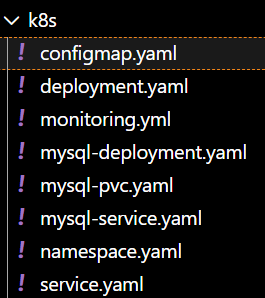

GKE

•  Cluster GKE 
•  Namespace actividad1 
•  Load Balancer 
•  Volúmenes Persistentes 
•  ConfigMaps 
•  Secrets

Cloud Build

cloudbuild.yaml

Responsable de:
•	Compilación Gradle
•	Construcción Docker
•	Push a Artifact Registry
•	Despliegue a GKE

Artifact Registry

artifactregistry.googleapis.com

Repositorio utilizado para imágenes Docker.


Código de Instrumentación OpenTelemetry

Gradle

implementation 'io.opentelemetry:opentelemetry-api'
implementation 'io.opentelemetry:opentelemetry-sdk'
implementation 'io.opentelemetry.instrumentation:opentelemetry-spring-boot-starter'

OTEL

OTEL_SERVICE_NAME=maestria-inventario-products
OTEL_EXPORTER_OTLP_ENDPOINT=http://otel-collector:4318
OTEL_TRACES_EXPORTER=otlp
OTEL_METRICS_EXPORTER=otlp
OTEL_LOGS_EXPORTER=otlp

Instrumentación HTTP

POST /products
GET /products

Base Datos

MySQL:
jdbc:mysql://mysql:3306/maestria_inventario_products

Plain Text

jdbc_connections_active
jdbc_connections_idle
hikaricp_connections_active
hikaricp_connections_idle

Instrumentación JVM

jvm_memory_used_bytes
jvm_gc_pause_seconds
jvm_threads_live_threads
process_cpu_usage
system_cpu_usage

Instrumentación Distribuida

Inventario Products
      │
      ├── MySQL
      │
      └── Audit Service


La solución incorpora los tres pilares fundamentales de observabilidad:

- Métricas

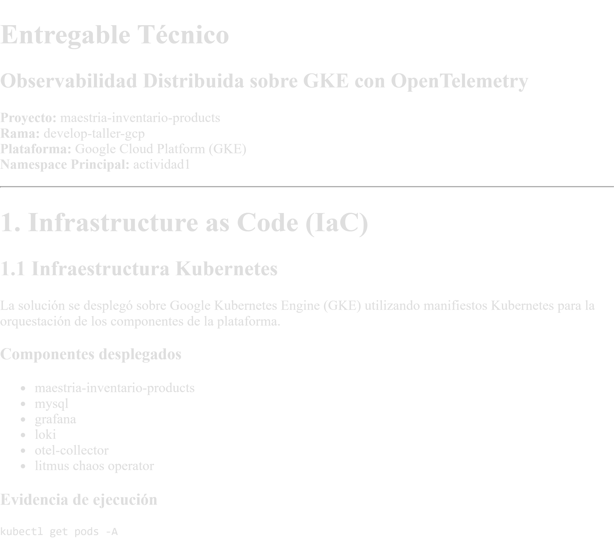

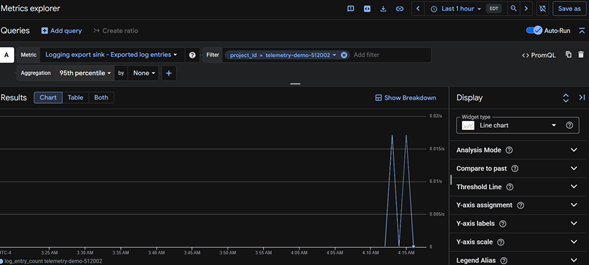

- Logs


- Trazas

Adicionalmente se implementó monitoreo de infraestructura Kubernetes, OpenTelemetry, Prometheus, Grafana, Loki y Chaos Engineering mediante Litmus.


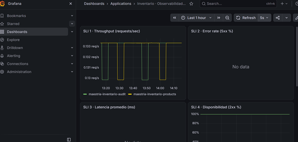

---

# 2. Arquitectura de la Solución

## Componentes Desplegados

### Aplicación
- maestria-inventario-products

GCP:

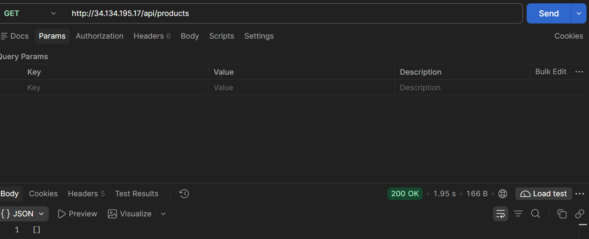

### Base de Datos
- MySQL

jdbc:mysql://mysql:3306/maestria_inventario_products

Plain Text

jdbc_connections_active
jdbc_connections_idle
hikaricp_connections_active
hikaricp_connections_idle


### Observabilidad
- OpenTelemetry Collector
- Prometheus (Google Managed Prometheus)

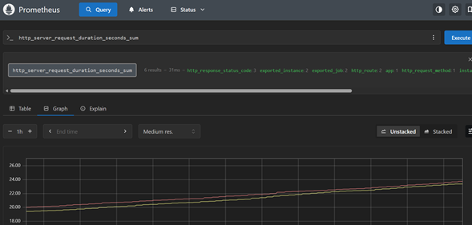
- Grafana
- Loki

### Chaos Engineering
- Litmus Chaos
- Chaos Operator

---

# 3. Infrastructure as Code (IaC)

## Despliegue en Kubernetes

La plataforma fue desplegada sobre Google Kubernetes Engine mediante manifiestos Kubernetes.

### Componentes Observados

```text
grafana

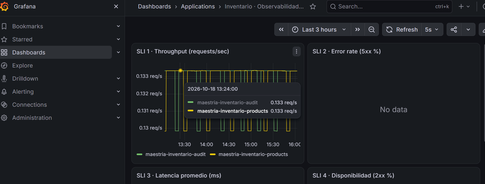
loki

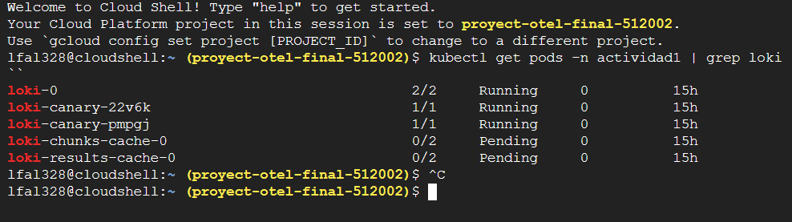

Se validó la ejecución correcta de Loki mediante la verificación de los pods desplegados en Kubernetes. El componente principal (loki-0) y los pods de validación Canary se encontraron en estado Running. Los componentes de caché permanecieron en estado Pending debido a restricciones de recursos del clúster; sin embargo, la funcionalidad principal de recolección y consulta de logs permaneció operativa.

mysql

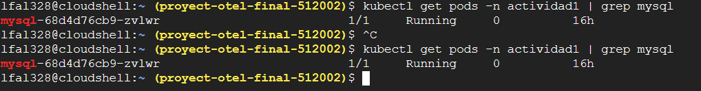

maestria-inventario-products

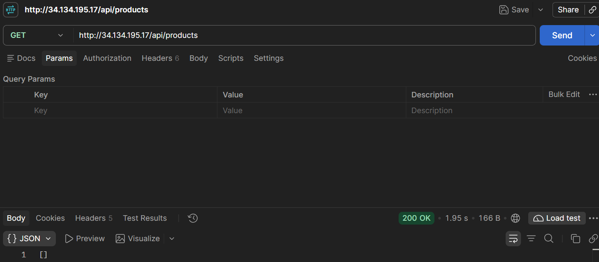

otel-collector

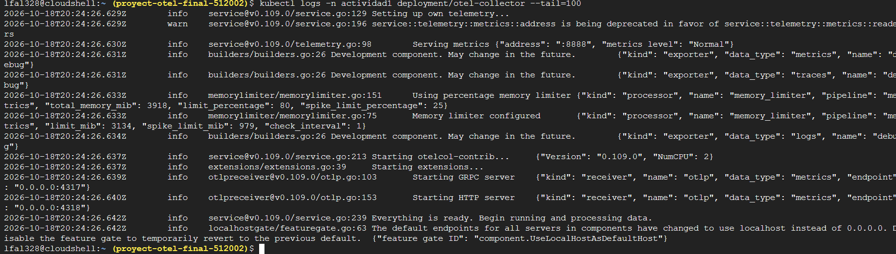

chaos-operator-ce
```

## Google Kubernetes Engine

Características utilizadas:

- Contenedores administrados
- Escalamiento automático
- Service Discovery
- Monitoreo nativo
- Integración con Cloud Monitoring
- Integración con Managed Prometheus

## Artifact Registry

Utilizado para almacenamiento y distribución de imágenes Docker.

## Cloud Build

Utilizado para compilar, construir imágenes y desplegar la solución.

---

# 4. Instrumentación OpenTelemetry

## Instrumentación HTTP

Métricas observadas:

```text
http_server_requests_seconds_bucket
http_server_requests_seconds_count
http_server_requests_seconds_sum
http_server_request_duration_seconds_bucket
http_server_request_duration_seconds_count
http_server_request_duration_seconds_sum
```

## Instrumentación JVM

```text
jvm_memory_used_bytes
jvm_memory_committed_bytes
jvm_memory_max_bytes
jvm_gc_duration_seconds_count
jvm_gc_pause_seconds_count
jvm_thread_count
```

## Instrumentación Base de Datos

### JDBC

```text
jdbc_connections_active
jdbc_connections_idle
jdbc_connections_max
jdbc_connections_min
```

### HikariCP

```text
hikaricp_connections_active
hikaricp_connections_idle
hikaricp_connections_pending
hikaricp_connections_max
```

## Instrumentación OpenTelemetry Collector

```text
otelcol_processor_incoming_items
otelcol_processor_outgoing_items
otelcol_exporter_sent_spans
otelcol_exporter_queue_size
```

---

# 5. Dashboard de Observabilidad

## Consultas PromQL Principales

### Throughput

```promql
sum(rate(http_server_requests_seconds_count[5m]))
```

### Latencia P95

```promql
histogram_quantile(0.95,sum(rate(http_server_requests_seconds_bucket[5m])) by (le))
```

### Latencia P99

```promql
histogram_quantile(0.99,sum(rate(http_server_requests_seconds_bucket[5m])) by (le))
```

### CPU

```promql
system_cpu_usage
```

### Memoria JVM

```promql
jvm_memory_used_bytes
```

---

# 6. Logs

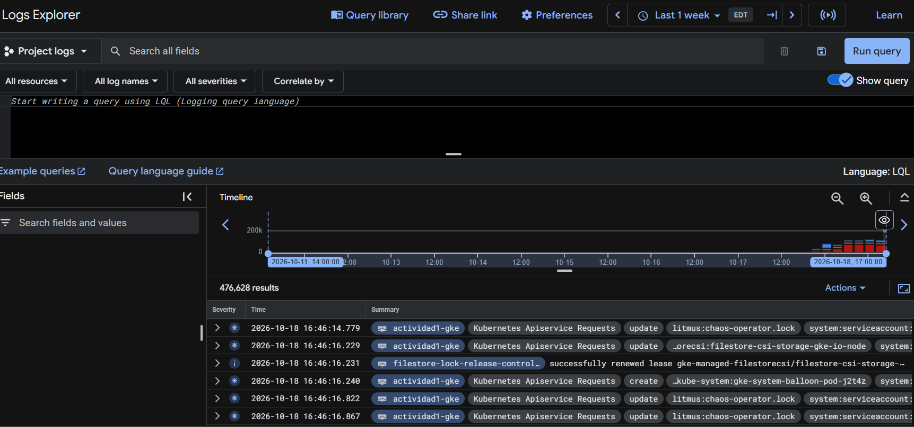

Flujo implementado:

```text
Aplicación
  ↓
OpenTelemetry
  ↓
Loki
  ↓
Grafana
```

---

# 7. Trazas Distribuidas

Flujo observado:

```text
Cliente
  ↓
maestria-inventario-products
  ↓
MySQL
```

---

# 8. Chaos Engineering

Namespace:

```text
litmus
```

Experimento observado:

```text
pod-network-latency
```

Métricas monitoreadas:

- Throughput
- Latencia P95
- Latencia P99
- CPU
- Memoria
- Spans exportados


Analitics:

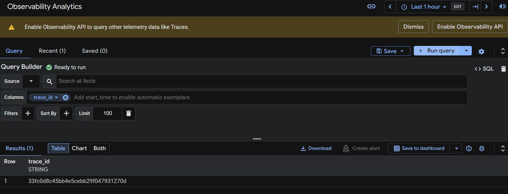

---

Scripts de Automatización
Despliegue
Shell
kubectl apply -f k8s/
Verificación
Shell
kubectl get pods -n actividad1
Shell
kubectl get svc -n actividad1
Observabilidad
Shell
kubectl logs deployment/otel-collector -n actividad1
Cloud Build
Shell
gcloud builds submit
Artifact Registry
Shell
docker push REGION-docker.pkg.dev/PROJECT/repository/image:tag
________________________________________
5. Evidencia de Métricas Observadas
Métricas detectadas en Prometheus:
Plain Text
http_server_requests_seconds_bucket
http_server_requests_seconds_count
http_server_request_duration_seconds_bucket
jvm_memory_used_bytes
jvm_memory_committed_bytes
process_cpu_usage
system_cpu_usage
jdbc_connections_active
jdbc_connections_idle
hikaricp_connections_active
hikaricp_connections_idle
otelcol_exporter_sent_spans
otelcol_processor_incoming_items
otelcol_processor_outgoing_items
________________________________________
6. Evidencia de Chaos Engineering
Namespace:
Plain Text
litmus
Experimentos observados:
Plain Text
pod-network-latency
Objetivos medidos:
•	Throughput
•	Latencia P95
•	Latencia P99
•	CPU
•	Memoria
•	Spans exportados

Observabilidad Implementada
Logs
Plain Text
Spring Boot → OTel Collector → Loki → Grafana
Métricas
Plain Text
Spring Boot → Prometheus → Grafana
Trazas
Plain Text
Spring Boot → OTel Collector → Jaeger

