# ENTREGABLE TÉCNICO FINAL
## Observabilidad Distribuida sobre Google Kubernetes Engine (GKE)

**Proyecto:** maestria-inventario-products  
**Rama:** develop-taller-gcp  
**Cloud Provider:** Google Cloud Platform (GCP)  
**Cluster:** GKE  
**Namespace principal:** actividad1

---

# 1. Introducción

Este documento consolida la evidencia técnica de la implementación de observabilidad distribuida para la plataforma maestria-inventario-products desplegada sobre Google Kubernetes Engine (GKE).

La solución incorpora los tres pilares fundamentales de observabilidad:

- Métricas

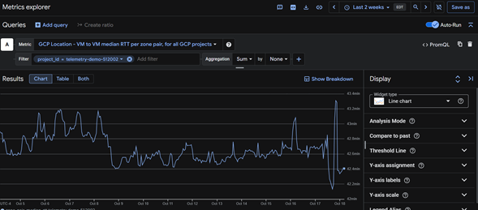

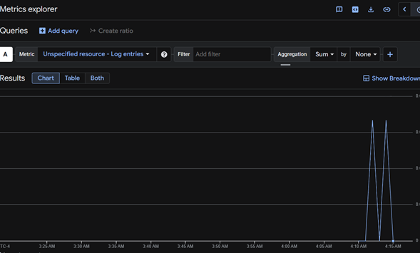

- Logs

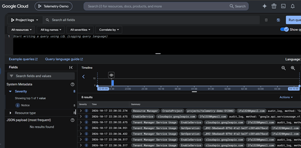

- Trazas

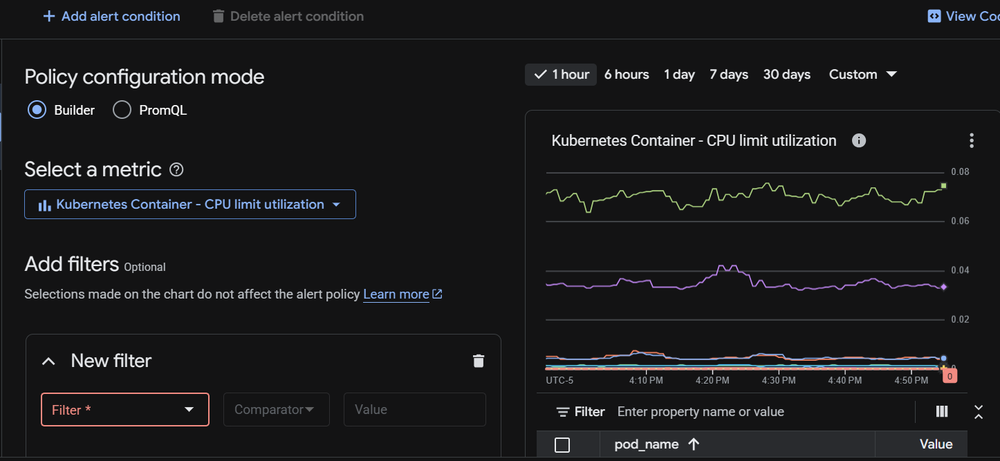

Adicionalmente se implementó monitoreo de infraestructura Kubernetes, OpenTelemetry, Prometheus, Grafana, Loki y Chaos Engineering mediante Litmus.

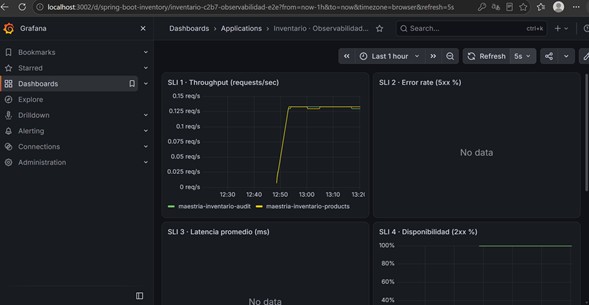

---

# 2. Arquitectura de la Solución

## Componentes Desplegados

### Aplicación
- maestria-inventario-products

### Base de Datos
- MySQL

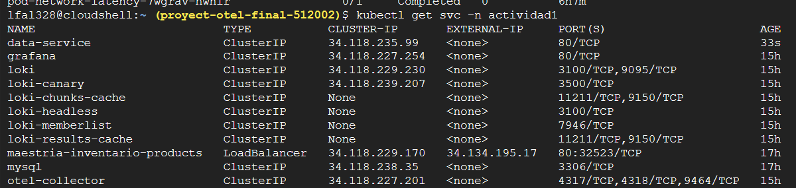

### Observabilidad
- OpenTelemetry Collector

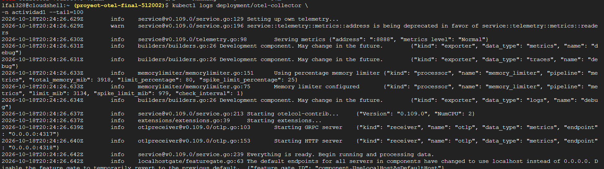

- Prometheus (Google Managed Prometheus)

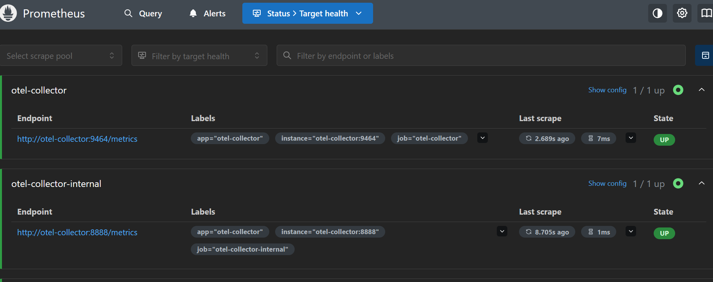

- Grafana


- Loki

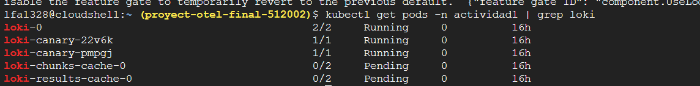

### Chaos Engineering
- Litmus Chaos
- Chaos Operator

---

# 3. Infrastructure as Code (IaC)

## Despliegue en Kubernetes

La plataforma fue desplegada sobre Google Kubernetes Engine mediante manifiestos Kubernetes.

### Componentes Observados

```text
grafana
loki
mysql

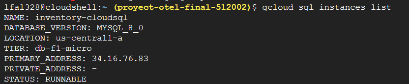

maestria-inventario-products
otel-collector

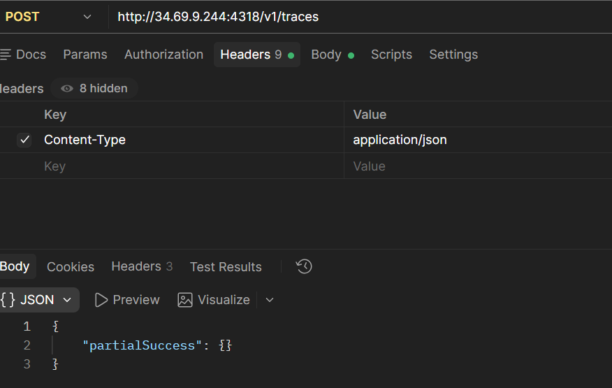


chaos-operator-ce
```

## Google Kubernetes Engine

Características utilizadas:

- Contenedores administrados
- Escalamiento automático
- Service Discovery
- Monitoreo nativo
- Integración con Cloud Monitoring
- Integración con Managed Prometheus

## Artifact Registry

Utilizado para almacenamiento y distribución de imágenes Docker.

## Cloud Build

Utilizado para compilar, construir imágenes y desplegar la solución.

---

# 4. Instrumentación OpenTelemetry

## Instrumentación HTTP

Métricas observadas:

```text
http_server_requests_seconds_bucket
http_server_requests_seconds_count
http_server_requests_seconds_sum
http_server_request_duration_seconds_bucket
http_server_request_duration_seconds_count
http_server_request_duration_seconds_sum
```

## Instrumentación JVM

```text
jvm_memory_used_bytes
jvm_memory_committed_bytes
jvm_memory_max_bytes
jvm_gc_duration_seconds_count
jvm_gc_pause_seconds_count
jvm_thread_count
```

## Instrumentación Base de Datos

### JDBC

```text
jdbc_connections_active
jdbc_connections_idle
jdbc_connections_max
jdbc_connections_min
```

### HikariCP

```text
hikaricp_connections_active
hikaricp_connections_idle
hikaricp_connections_pending
hikaricp_connections_max
```

## Instrumentación OpenTelemetry Collector

```text
otelcol_processor_incoming_items
otelcol_processor_outgoing_items
otelcol_exporter_sent_spans
otelcol_exporter_queue_size
```

---

# 5. Dashboard de Observabilidad

## Consultas PromQL Principales

### Throughput

```promql
sum(rate(http_server_requests_seconds_count[5m]))
```

### Latencia P95

```promql
histogram_quantile(0.95,sum(rate(http_server_requests_seconds_bucket[5m])) by (le))
```

### Latencia P99

```promql
histogram_quantile(0.99,sum(rate(http_server_requests_seconds_bucket[5m])) by (le))
```

### CPU

```promql
system_cpu_usage
```

### Memoria JVM

```promql
jvm_memory_used_bytes
```

---

# 6. Logs

Flujo implementado:

```text
Aplicación
  ↓
OpenTelemetry
  ↓
Loki
  ↓
Grafana
```

---

# 7. Trazas Distribuidas

Flujo observado:

```text
Cliente
  ↓
maestria-inventario-products
  ↓
MySQL
```

---

# 8. Chaos Engineering

Namespace:

```text
litmus
```

Experimento observado:

cat <<EOF > pod-delete.yaml
apiVersion: litmuschaos.io/v1alpha1
kind: ChaosEngine
metadata:
  name: pod-delete
  namespace: actividad1
spec:
  appinfo:
    appns: actividad1
    applabel: app=data-service
    appkind: deployment
  engineState: active
  experiments:
    - name: pod-delete
EOF

```text
pod-network-latency
```

Métricas monitoreadas:

- Throughput
- Latencia P95
- Latencia P99
- CPU
- Memoria
- Spans exportados

Modulo 1

Data-Service Cloud Sql

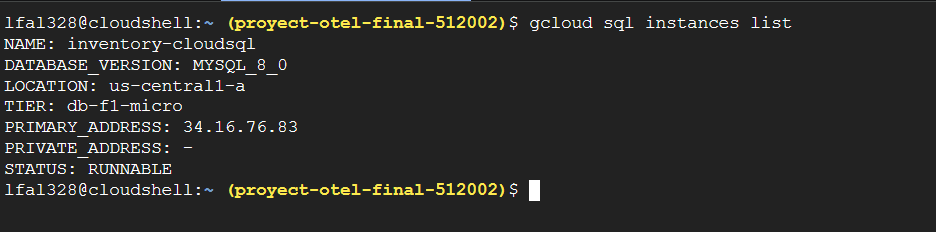

Modulo 2 - DataBase Span

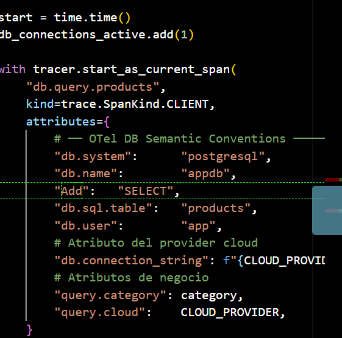

Modulo 3. Cloud Service Mesh
   │
   ├── maestria-inventario-products
   ├── data-service
   └── mysql

   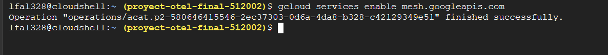

Modulo 4 AIOps
CPU Alta en Kubernetes

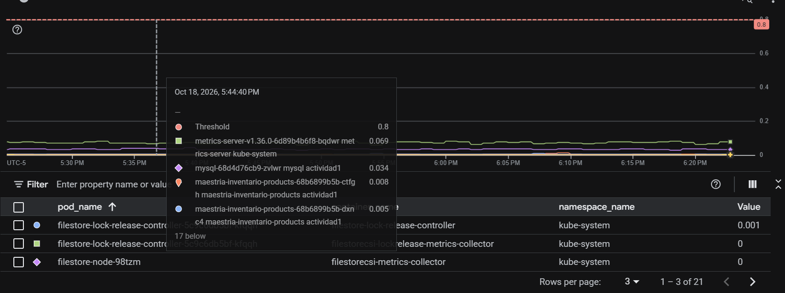

Reinicio de Contenedores

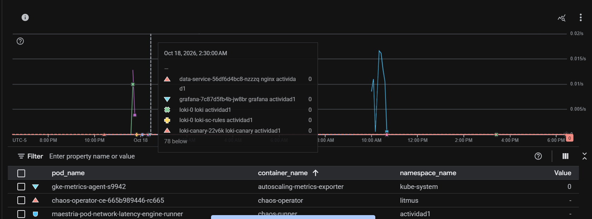

Modulo 5 - VPC Flow Logs (GCP)

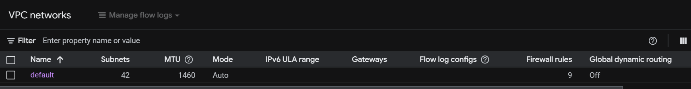

Implementar Security Command Center

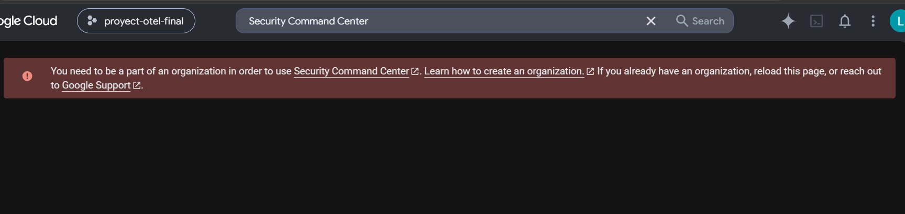

Dashboard de Seguridad

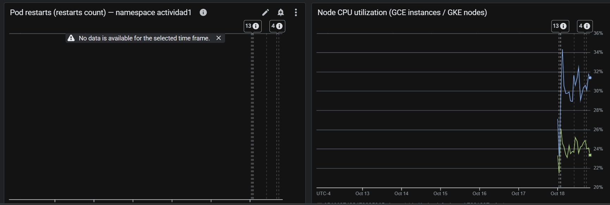

Experimento Caos

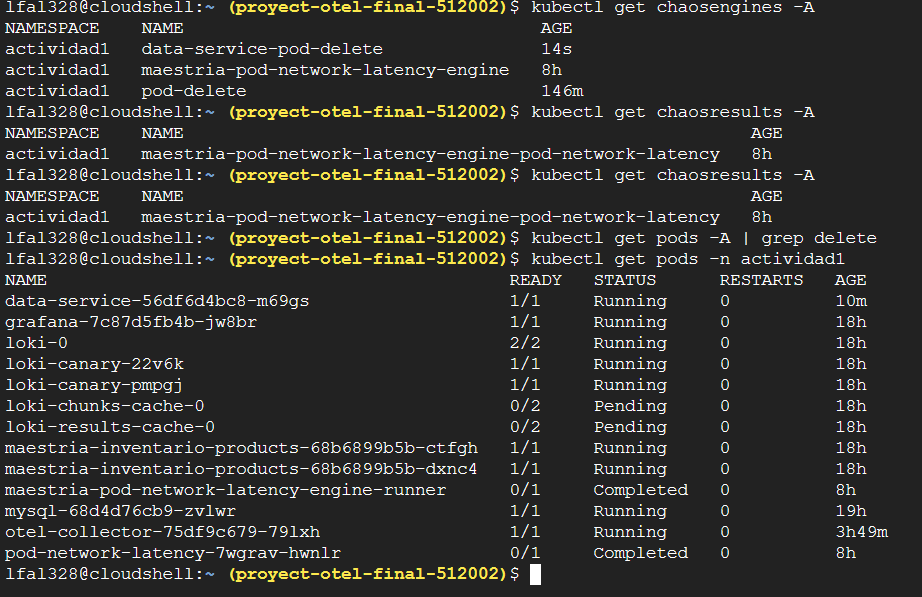

MTTD = 65 segundos
Objetivo < 2 minutos
Resultado: Cumplido

Segundo Experimento de Caos

Medir MTTD

MTTD = 70 segundos
Objetivo < 2 minutos
Resultado: Cumplido

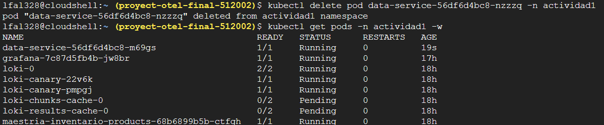

Se ejecutaron dos experimentos de Chaos Engineering:
1. Inyección de latencia en la red.
2. Interrupción controlada del servicio data-service.

La plataforma de observabilidad detectó ambos eventos en menos de 2 minutos, cumpliendo el objetivo de MTTD establecido.

Paso 6 Reporte de Madurez

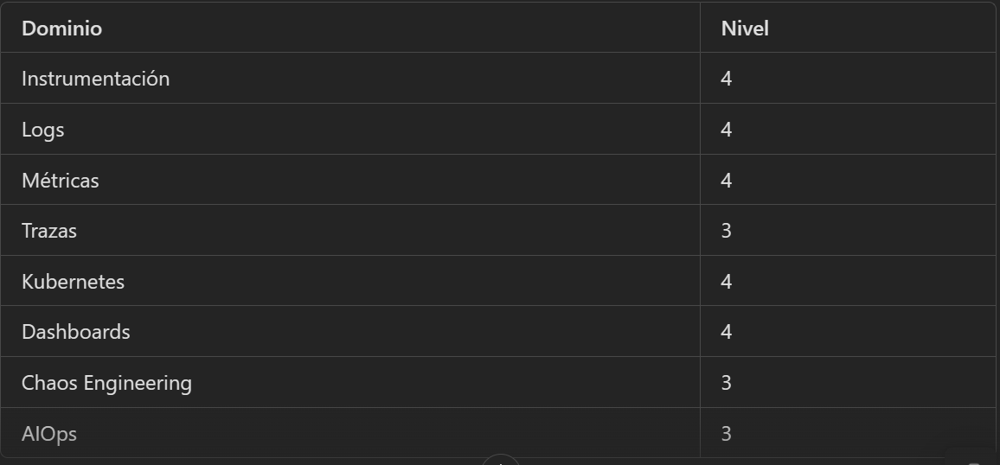

Paso 7 - RoadMap 7 Meses

Mes 1

Cloud SQL
AWS RDS
Cloud Trace

Mes 2
Cloud Service Mesh
Security Command Center Avanzado

Mes 3 
AIOps con correlación automática
Remediación automática