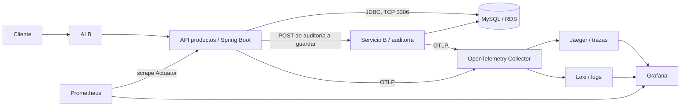

# Entrega técnica: Game Day local de resiliencia

- **Proyecto:** `maestria-inventario-products`
- **Asignatura:** Maestría — SRE, resiliencia y sistemas distribuidos
- **Dirigido a:** Profesora de maestría
- **Fecha de validación local:** 16 de octubre de 2026
- **Entorno:** Docker Compose local; experimentos sin cambios ni inyección de fallos en AWS.

## 1. Resumen ejecutivo

Este Game Day evalúa el servicio local de productos ante contención de CPU, partición de red hacia MySQL y reinicio de MySQL. Las tres hipótesis se definieron para el Docker Compose local activo y se ejecutaron con herramientas disponibles en Docker Desktop, PowerShell, Prometheus y los logs de contenedor; no dependen de ECS, AWS, H2 ni de imágenes nuevas para inyectar los fallos.

En la validación del 16 de octubre, la carga de CPU de dos workers durante 25 s mantuvo 171/171 solicitudes GET en HTTP 200 (p95 38,65 ms); la desconexión temporal de MySQL produjo un fallo de transporte y la API se recuperó en la primera comprobación tras reconectar; y, tras reiniciar MySQL, la aplicación volvió a responder HTTP 200, conservó sus datos y recuperó health `UP`.

Las pruebas no validan autoscaling ni comportamiento de producción. La telemetría confirmada para esta ejecución es Prometheus y HTTP, health de Actuator, logs de Docker y el estado/health de los contenedores; no se presupone captura de trazas distribuidas porque Jaeger y el OpenTelemetry Collector no estaban activos.

La sección 4 reúne las tres hipótesis en el formato de Principios del Caos y define para cada una el fallo, el blast radius, la duración, el rollback y las señales de observabilidad. La sección 4.4 valida el cumplimiento para el alcance local efectivamente probado.

## 2. Servicio objetivo y arquitectura

### 2.1 Servicio seleccionado

El objetivo es el servicio de productos **`maestria-inventario-products`**, específicamente:

- `GET /api/products` → `ProductController.getAllProducts()` → `ProductService.getAllProducts()` → `ProductRepository.findAll()` → MySQL.
- `POST /api/products` → `ProductController.saveProduct()` → `ProductService.saveProduct()` → repositorio/MySQL. Después de guardar, el servicio puede invocar el servicio de auditoría.

Las pruebas de esta revisión usan `GET /api/products` para medir disponibilidad/latencia y la recuperación ante fallos de la dependencia MySQL; no hacen escrituras de negocio.

### 2.2 Componentes y dependencias principales

| Componente | Función | Dependencia/observación |
| --- | --- | --- |
| API de productos (Spring Boot 3.3.5, Java 21) | Expone la API REST y Actuator; puerto 9090 en el contenedor, 9092 en el host local. | MySQL por JDBC; `ProductAuditClient` al guardar si está habilitado. |
| MySQL 8 | Persistencia de productos y eventos de auditoría en la arquitectura local declarada. | TCP 3306 dentro de la red Compose; las pruebas se conectan mediante el nombre `mysql`. |
| Servicio B (auditoría) | Recibe eventos HTTP posteriores a la creación de un producto. | API de productos → servicio B; servicio B → MySQL. No es dependencia de `GET /api/products`. |
| Prometheus | Recopila métricas de Actuator y del Collector. | Scrape configurado cada 15 s; `/actuator/prometheus`. |
| OpenTelemetry Collector, Jaeger, Loki y Grafana | Recolección de telemetría, trazas, logs y visualización en la arquitectura local. | Configurados en Compose, pero no activos durante estas tres pruebas. |
| ECS Fargate, ALB, RDS y CloudWatch (destino AWS) | Despliegue y observabilidad de la versión objetivo en AWS. | El script de provisioning fija CPU `1024` y memoria `2048` por tarea; no configura Container Insights ni una política de autoscaling ECS. |

El diagrama representa la arquitectura declarada de la solución. En H2 y H3 se verificó específicamente la conexión entre la API Dockerizada y MySQL; no se asume que ALB, RDS, ECS o todos los componentes de observabilidad estuvieran activos en este Game Day local.

## 3. Principios de seguridad del Game Day

- **Entorno:** local y aislado de AWS. No se modificaron recursos cloud.
- **Radio de impacto:** H1 consume CPU compartida en Docker Desktop; H2 desconecta MySQL de todos los peers de la red Compose; H3 reinicia MySQL y afecta temporalmente a sus consumidores.
- **Datos:** las tres pruebas fueron de lectura/recuperación; el conteo de productos antes y después de reiniciar MySQL se mantuvo igual. No se alteraron registros de negocio.
- **Ventanas:** fallos con duración máxima controlada y límites de timeout en los generadores de carga.
- **Abortar:** retirar la inyección inmediatamente si el health check queda `DOWN`, aparecen errores en masa, el servicio deja de responder o la recuperación no es inmediata.
- **Recuperar:** limpiar las reglas o procesos de carga, verificar health check, pool y dependencia; comprobar que la tasa de error vuelve a la línea base.
- **Aprobación:** comparar disponibilidad, p95 y métricas de recursos con los umbrales de cada hipótesis. Un resultado exitoso en una muestra local no se extrapola a producción.

## 4. Hipótesis y diseño de experimentos

### Resumen de los tres experimentos de caos

| Experimento | Tipo de fallo | Inyección local |
| --- | --- | --- |
| H1 — contención de CPU | Agotamiento de recursos (CPU) | Contenedor temporal con dos workers de CPU durante un máximo de 25 s, mientras se mide `GET /api/products`. |
| H2 — partición de red hacia MySQL | Partición de red (network partition) | Desconectar temporalmente el contenedor MySQL de la red Compose y volver a conectarlo. |
| H3 — reinicio de MySQL | Indisponibilidad/reinicio de dependencia | Reiniciar MySQL con 10 s de gracia y medir cuándo se recuperan la API y su conexión a la base de datos. |

### H1 — contención acotada de CPU durante lecturas

**Hipótesis:** «En estado estable, cuando un contenedor temporal consume hasta 2 CPU durante 25 segundos mientras se consulta `GET /api/products`, esperamos que al menos el 99 % de las solicitudes responda HTTP 200, que el p95 sea inferior a 250 ms y que la API continúe healthy».

| Elemento | Diseño |
| --- | --- |
| Estado estable | `app`, MySQL y Prometheus healthy; comprobar `GET /api/products` y `system_cpu_usage` antes de iniciar la carga. |
| Tipo de fallo | Agotamiento/contención de recursos de CPU en el host local de Docker Desktop. |
| Experimento local | Lanzar `ubuntu:latest` con `docker run --rm --cpus=2` y dos workers `yes` limitados por `timeout 25s`; durante la carga consultar `GET /api/products` y leer `system_cpu_usage` en Prometheus. |
| Blast radius | CPU compartida de Docker Desktop y las cargas que se ejecuten allí; la API solo recibe GET, sin escrituras. No se afirma que la CPU del contenedor `app` tenga un límite configurado. |
| Duración | Carga máxima de 25 s, terminación por `timeout` y eliminación del contenedor por `--rm`; hasta 28 s de mediciones HTTP. |
| SLI / umbrales | Porcentaje HTTP 200 ≥ 99 %, p95 < 250 ms y health de Actuator `UP`. Registrar además el máximo observado de `system_cpu_usage`. |
| Logs, métricas y trazas | Salida HTTP y tiempos del generador; `system_cpu_usage`, `process_cpu_usage` y `http.server.requests` en Prometheus; logs de aplicación para errores. No exigir spans distribuidos: Jaeger/Collector no estaban activos. |
| Rollback automático/abort | `timeout` termina la carga y `--rm` elimina el contenedor. Detener la prueba si health cae, si errores consecutivos impiden medir o si el p95 excede 250 ms; verificar health al terminar. |

### H2 — partición temporal de red entre la API y MySQL

**Hipótesis:** «En estado estable, cuando se desconecta MySQL de la red Compose durante una comprobación de lectura, esperamos que la API falle esa solicitud mientras la dependencia está aislada y vuelva a responder HTTP 200 y health `UP` en menos de 30 segundos después de reconectar MySQL».

| Elemento | Diseño |
| --- | --- |
| Estado estable | API y MySQL healthy; `GET /api/products` devuelve 200; registrar red Compose y estado de salud inicial. |
| Tipo de fallo | Network partition a nivel de conectividad del contenedor MySQL. |
| Experimento local | `docker network disconnect` sobre MySQL; intentar un GET desde el host al puerto publicado de la API; reconectar MySQL a la misma red con alias `mysql` y repetir GET/health. |
| Blast radius | Aísla MySQL de todos los peers de la red Compose, incluidos otros consumidores; el puerto HTTP publicado de la API permanece accesible desde el host. Solo se consulta, no se modifica el inventario. |
| Duración | Máximo 10 s de aislamiento, incluido el GET con timeout de 8 s; recuperación observada hasta 30 s después de reconectar. |
| SLI / umbrales | Confirmar fallo de transporte durante la partición; después de reconectar: HTTP 200, health de Actuator `UP` y componente DB `UP` en menos de 30 s. |
| Logs, métricas y trazas | HTTP status/timeout del cliente; logs de Spring/Hikari que registren conexiones inválidas o JDBC; health de Actuator y `http.server.requests` en Prometheus. Sin Jaeger/Collector activos, las trazas no forman parte del criterio de aprobación. |
| Rollback automático/abort | El runner reconecta MySQL en `finally` y restaura el alias `mysql`; verificar que ambos contenedores siguen conectados, MySQL healthy y API/DB `UP`. Abortar la carga si no se puede restablecer la red inmediatamente. |

### H3 — reinicio controlado de MySQL y recuperación de la API

**Hipótesis:** «En estado estable, cuando MySQL se reinicia con un periodo de gracia de 10 segundos, esperamos que MySQL vuelva a healthy y que `GET /api/products` y el health de la API se recuperen en menos de 30 segundos sin pérdida de los productos existentes».

| Elemento | Diseño |
| --- | --- |
| Estado estable | MySQL y API healthy; registrar cantidad de productos y comprobar GET 200 antes del reinicio. |
| Tipo de fallo | Reinicio de dependencia de persistencia. |
| Experimento local | Ejecutar `docker restart --time 10 inventario-products-mysql`; esperar MySQL healthy; sondear GET y Actuator hasta la recuperación o el límite de 60 s. |
| Blast radius | MySQL compartido y todos sus consumidores locales; se afecta temporalmente la lectura/escritura durante el reinicio. Este experimento no envía escrituras. |
| Duración | Reinicio con gracia de 10 s; ventana total máxima de verificación de 60 s. |
| SLI / umbrales | MySQL health `healthy`; GET HTTP 200 y health/component DB de Actuator `UP` en menos de 30 s desde la disponibilidad de MySQL; conteo de productos idéntico antes y después. |
| Logs, métricas y trazas | Estado/health del contenedor MySQL; logs de la API y Hikari ante conexiones invalidadas; `http.server.requests`, health DB y estado de MySQL. Trazas distribuidas no requeridas mientras Collector/Jaeger no estén activos. |
| Rollback automático/abort | El reinicio del contenedor es acotado y no cambia configuración ni volumen. El runner espera hasta 60 s; si no se recupera, inicia MySQL y verifica API/DB manualmente antes de finalizar. |

### 4.4 Validación frente al framework de Game Days

| Requisito | Evidencia en este documento | Evaluación |
| --- | --- | --- |
| Seleccionar un servicio o arquitectura objetivo | API de productos y su ruta de persistencia/dependencias, con diagrama y alcance en la sección 2. | **Cumple.** |
| Formular tres hipótesis en formato «En estado estable, cuando…, esperamos que…» | H1, H2 y H3 expresan una condición local reproducible y criterios de salida medibles. | **Cumple.** |
| Diseñar tres experimentos con tipo de fallo, blast radius, duración y rollback automático | Las tablas identifican la acción de inyección, el alcance, la ventana y la recuperación local. Se usaron límites temporales y `finally` para la partición. | **Cumple para el entorno local probado.** |
| Definir SLI, logs y trazas para verificar cada hipótesis | Se consultaron HTTP, tiempos, CPU de Prometheus, Actuator, estado/health Docker y logs de contenedor. Jaeger/Collector no estaban activos; por tanto, no se usan trazas como condición de aprobación. | **Cumple con métricas y logs locales; trazas excluidas explícitamente.** |

**Dictamen:** las tres hipótesis son ejecutables y se validaron en el stack local disponible. El alcance queda limitado al Compose local; no se validan ECS, autoscaling, otros entornos ni trazas distribuidas.

## 5. Métricas de observabilidad y SLI

| Área | Métrica/evidencia | Uso en la evaluación |
| --- | --- | --- |
| Disponibilidad/recuperación | Solicitudes HTTP 200, error de transporte, health de Actuator y health de MySQL en Docker. | Confirma el impacto esperado durante la partición y la recuperación después de restaurar la dependencia. |
| Latencia | Duración de cada solicitud HTTP y p95 calculado por el runner; tiempo de recuperación tras reconectar/reiniciar MySQL. | Comprueba los límites de 250 ms para CPU y 30 s para recuperación de dependencias. |
| CPU | `system_cpu_usage` consultado en Prometheus durante H1; `process_cpu_usage` disponible como métrica de Actuator. | Registra el impacto de la contención temporal; no se interpreta como saturación de CPU de un contenedor con cuota propia. |
| Persistencia/conexiones | Health `components.db`, estado del contenedor MySQL y conteo de productos antes/después. | Confirma disponibilidad de la conexión y ausencia de pérdida de datos en el reinicio. |
| Logs | Logs Docker de la aplicación/MySQL y salida/tiempos HTTP del runner. | Confirma fallos transitorios de conexión, recuperación y ausencia de errores persistentes. |
| Trazas | No usadas como criterio en esta ejecución. | Jaeger y OpenTelemetry Collector no estaban activos; Prometheus, Actuator y Docker logs fueron la evidencia disponible. |

Prometheus scrapea Actuator cada 15 s. Para esta validación se consultaron directamente sus endpoints HTTP, además de Docker health y logs; no se afirma que Grafana o Jaeger hayan almacenado las pruebas.

## 6. Procedimiento ejecutado y resultados

### 6.1 H1 — contención de CPU

**Procedimiento:** mientras un contenedor `ubuntu:latest` ejecutaba dos workers CPU con límite de 2 CPU y `timeout 25s`, se consultó `GET /api/products` repetidamente y se sondeó `system_cpu_usage` en Prometheus. La carga del contenedor terminó automáticamente y el contenedor temporal se eliminó.

| Medición | Criterio | Observado | Evaluación |
| --- | --- | --- | --- |
| Solicitudes GET | Éxito ≥ 99 % | 171/171 HTTP 200 (100 %) | Cumple |
| Latencia HTTP | p95 < 250 ms | p95 38,65 ms; máximo 61,56 ms | Cumple |
| Salud/CPU | API healthy; registrar CPU | API healthy; `system_cpu_usage` máximo 0,3267 | Cumple para carga acotada |

El test valida contención local acotada, no saturación completa de la VM ni de una cuota de CPU del contenedor de la API.

**Reflexión — debilidad sistémica:** no se observó degradación por encima de los umbrales: todas las lecturas tuvieron éxito y el p95 se mantuvo bajo. Sin embargo, el ensayo no llegó a demostrar cómo se comporta la API bajo saturación real: la carga competía por CPU en Docker Desktop, no se aplicó una cuota al contenedor `app` y el máximo medido de `system_cpu_usage` fue 0,3267. La debilidad identificada es la falta de evidencia sobre el comportamiento y los límites de recursos de la aplicación bajo presión representativa, no un fallo confirmado del servicio.

**Remediación propuesta:** definir y configurar límites/ reservas de CPU para `app` en Compose, medir CPU del contenedor y señales de throttling además de CPU del host, y repetir con carga gradual de GET hasta alcanzar el límite previsto. Mantener límites de duración y abortar si falla health o se excede el presupuesto de latencia.

### 6.2 H2 — partición de red app↔MySQL

**Procedimiento:** con app y MySQL healthy y GET de control exitoso, se desconectó MySQL de la red Compose, se intentó una lectura con timeout de cliente y se reconectó en un bloque `finally` con los alias de Compose. Después se sondeó GET y Actuator.

| Medición | Criterio | Observado | Evaluación |
| --- | --- | --- | --- |
| GET durante aislamiento | La solicitud afectada falla | Error de transporte; no se recibió respuesta HTTP (status de cliente 0) | Cumple |
| Recuperación tras reconexión | GET 200 y health/DB UP en < 30 s | GET 200 en la primera comprobación (~1 s); health y DB `UP` | Cumple |
| Limpieza | MySQL vuelve a conectarse a la red | Se reañadió a `maestria-inventario-products_default` con alias `mysql`; app healthy | Cumple |

El aislamiento de red es más amplio que filtrar solo el puerto 3306: desconecta MySQL de los peers de la red Compose. No se hicieron escrituras durante la prueba.

**Reflexión — debilidad sistémica:** durante la partición la solicitud de lectura no obtuvo respuesta HTTP, aunque la API volvió a operar en la primera comprobación tras restablecer la red. Por tanto, una interrupción de MySQL se propaga como fallo visible al consumidor de esa solicitud; la recuperación posterior no la rescata. El alcance del aislamiento también afecta a todos los consumidores locales de MySQL, no únicamente a la API de productos.

**Remediación propuesta:** establecer timeouts finitos y coherentes para conexión/lectura de JDBC y para las solicitudes HTTP, y asegurar que el health/readiness refleje la dependencia según el comportamiento operativo deseado. Si se implementan retries, limitarlos a errores transitorios, con backoff+jitter, un máximo pequeño y un deadline total para no prolongar solicitudes ni sobrecargar MySQL al volver. Repetir el test verificando status HTTP, latencia y health durante el fallo y tras la recuperación.

### 6.3 H3 — reinicio de MySQL

**Procedimiento:** registrar health de app/DB y cantidad de productos; ejecutar `docker restart --time 10 inventario-products-mysql`; esperar el health check de MySQL y sondear GET/Actuator hasta 60 s.

| Medición | Criterio | Observado | Evaluación |
| --- | --- | --- | --- |
| MySQL | Vuelve a `healthy` | `healthy` | Cumple |
| Recuperación de API | GET 200 y health/DB UP en < 30 s | GET 200 en primera comprobación (~1 s); ambos health `UP` | Cumple |
| Integridad | Conteo de productos sin cambios | 1 antes y 1 después | Cumple |
| Ventana total | ≤ 60 s | 15,3 s | Cumple |

Los logs de Hikari registraron conexiones invalidadas durante la recuperación; no hubo pérdida del registro existente.

**Reflexión — debilidad sistémica:** la API se recuperó y conservó los datos, pero Hikari registró advertencias al validar conexiones que MySQL había cerrado. Esto revela conexiones del pool que pueden quedar obsoletas durante un reinicio y producir errores o latencia transitoria en solicitudes concurrentes; la prueba no observó pérdida de datos ni una interrupción sostenida.

**Remediación propuesta:** revisar la configuración de Hikari y los timeouts de conexión del driver para que las conexiones se descarten/recreen oportunamente ante la indisponibilidad de MySQL; mantener health checks y alertas sobre errores JDBC, conexiones activas/pendientes y latencia. Validar con solicitudes concurrentes durante el reinicio, confirmando recuperación dentro del límite y conteo de datos sin cambios. No añadir reintentos de escritura sin idempotencia.

## 7. Resultado global frente a criterios de aceptación

| Criterio | Evidencia | Estado |
| --- | --- | --- |
| H1 CPU local | 171/171 HTTP 200; p95 38,65 ms; API healthy | **Cumple** los umbrales locales definidos. |
| H2 partición de red | Fallo de transporte durante aislamiento; GET 200 y health/DB UP ~1 s tras reconectar | **Cumple** el criterio de recuperación local. |
| H3 reinicio de MySQL | MySQL healthy; GET 200 y API/DB UP ~1 s después; inventario sin cambios; 15,3 s total | **Cumple** el criterio de recuperación local. |
| Logs y métricas locales | Prometheus CPU, mediciones HTTP, Actuator y health/logs Docker | **Disponible y verificado.** |
| Trazas distribuidas | Jaeger/Collector no estaban activos | **No evaluadas ni necesarias para aprobar estas hipótesis locales.** |

## 8. Plan de remediación y retest

1. **CPU:** definir límites/ reservas locales para `app`, aumentar gradualmente la carga GET y medir CPU/throttling del contenedor junto con p95 y errores.
2. **Partición:** definir timeouts finitos JDBC/HTTP y, si se justifica, retries acotados; repetir midiendo la respuesta observada por el cliente y la recuperación tras reconectar.
3. **Reinicio de MySQL:** revisar ciclo de vida de conexiones Hikari y timeouts del driver; repetir con solicitudes concurrentes y alertas de pool/errores.
4. Si se requiere validar trazas, iniciar Jaeger y el OpenTelemetry Collector antes de los experimentos y comprobar spans HTTP/JDBC; no son necesarios para los criterios locales actuales.

## 9. Límites de validez

- Las muestras son pruebas locales breves y no equivalen a carga sostenida ni a producción.
- H1 midió contención de CPU compartida en Docker Desktop; no saturó ni impuso una cuota específica al contenedor de la aplicación.
- H2 aisló MySQL de toda la red Compose, no solo de la aplicación.
- H3 fue un reinicio controlado de MySQL, no una terminación abrupta del proceso ni corrupción de datos.
- Los umbrales (250 ms, 30 s) son criterios de este Game Day, no SLOs formales.
- Jaeger y el Collector no estaban activos; no hay afirmaciones de trazas distribuidas capturadas.

## 10. Trazabilidad de evidencias del laboratorio

- Esta entrega incluye los procedimientos y resultados de las tres hipótesis locales validadas el 16 de octubre de 2026.
- `evidence/chaos/game-day-hypotheses-retest-2026-10-15.md`, `game-day-h3-mysql-packet-loss-2026-10-15.md` y `game-day-cpu-stress-2026-10-15.md` son evidencias históricas de experimentos anteriores y no son los criterios de aceptación de esta revisión.
- `prometheus.yml` — scrape de Actuator/Collector/servicio B.
- `src/main/java/com/arq/maestria_inventario_products/service/ProductService.java` — operaciones de guardado y lectura.
- `src/main/java/com/arq/maestria_inventario_products/service/ProductAuditClient.java` — llamada de auditoría después de guardar.
- `deploy/aws/provision-aws.ps1` — definición de recursos y límites actuales de tarea; no configura autoscaling ECS.
